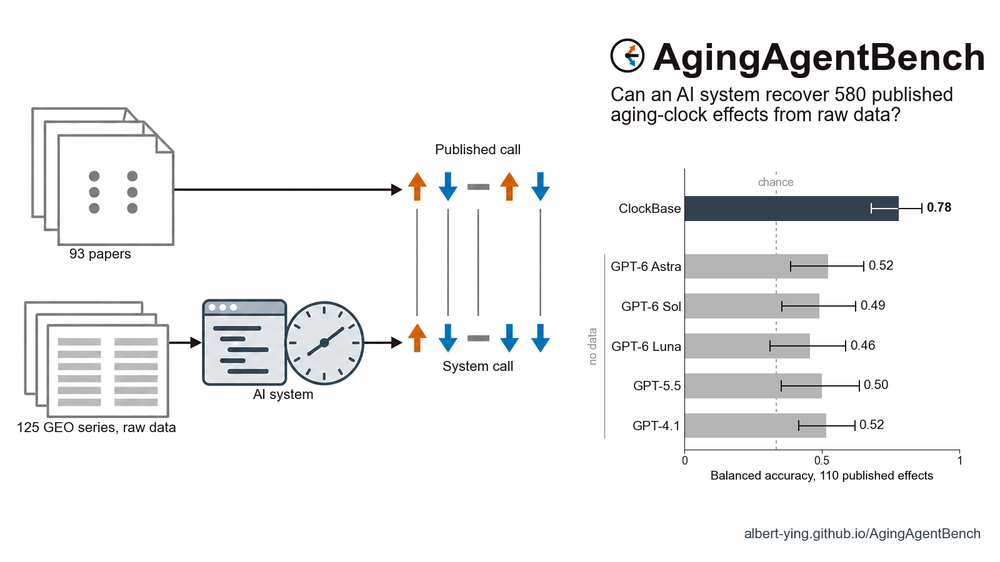

# AgingAgentBench

[](https://albert-ying.github.io/AgingAgentBench/)

[Website](https://albert-ying.github.io/AgingAgentBench/)

AgingAgentBench measures whether an analysis system recovers aging-clock
effects reported in published studies of public GEO data. You can evaluate
an agent, a pipeline, or a language model using the same reference outcomes.
The reference is what each paper reports for its clock, measure, and groups.

The published-effects dataset contains 580 contrasts from 93 papers on 125
GEO series. A separate expert task tests group choice and orientation against
complete groups defined from sample annotation for 32 mouse RNA-seq and 16
human DNA methylation series with scored results.

The [repository](https://github.com/albert-ying/AgingAgentBench) contains the
package and reference data. The [site](https://albert-ying.github.io/AgingAgentBench/)
describes the benchmark.

## Quick start

Use Python 3.10 or later. Installation requires only NumPy and SciPy
at runtime. All scoring runs locally without API calls.

```sh
python3 -m venv .venv
source .venv/bin/activate
python -m pip install -e '.[test]'
agingagentbench score \
  --predictions reference_results/clockbase_paper_groups.csv \
  --cohort main110
pytest -q
```

The command prints JSON and writes it to
`scores/clockbase_paper_groups_main110.json`. Use `--output FILE` to choose
another destination. It recovers 10/16 published decreases, 30/36 increases,
and 51/58 null results, with balanced accuracy 0.7792 and a 95% interval of
0.6788 to 0.8641. Direction AUROC is 0.9965, with an interval of 0.9810 to
1.0000. The paper rounds these to 0.78 and 1.00.

The paper's year-effect comparison uses 30 effects from seven papers. Two of
these 30 results were recomputed after removing clock outputs above 1,000
years; four rows in the full guarded Welch variant use this guard. To reproduce
this comparison, submit the guarded estimates with their explicit year units:

```sh
agingagentbench score \
  --predictions reference_results/clockbase_paper_groups_guarded.csv \
  --effects reference_results/effect_pairs_years.csv
```

This gives Spearman correlation 0.6071, an interval of 0.2725 to 0.9313, and
median absolute difference 1.5137 years. `--effects` reads only the selection
file's `record_id` column; estimates always come from your predictions. The
30-record effect set is independent of the selected call cohort. Predictions
without year estimates score zero effect pairs. The adjusted-test reference
CSV has no effect estimates.

## Evaluate your system

For each record, compare the case group with the control group using the
specified clock and measure. Start from the answer-free `data/tasks.jsonl`
file and preserve `record_id` in your output. Use the
paper's significance threshold, or P < 0.05 when it states none. Submit a
CSV or JSONL file with the following fields.

| Field | Requirement |
| --- | --- |
| `record_id` | Identifier from `data/tasks.jsonl`. |
| `call` | `higher`, `lower`, or `not significant`. |
| `direction` | `higher`, `lower`, or `none`. Required with `p_value` for a nonsignificant call unless a signed `effect` supplies it. Significant calls imply their direction. |
| `p_value` | Optional two-sided P value between 0 and 1 for direction AUROC; direction-only answers with a P value also enter AUROC. |
| `effect` | Optional signed case-minus-control estimate. |
| `effect_unit` | Use `years` for an effect to enter the year-effect correlation. `--effects reference_results/effect_pairs_years.csv` restricts it to the paper's 30 record IDs; the default uses all eligible predictions in the call cohort. |

The first line of the following example is the CSV header. The example row
is copied from the shipped ClockBase reference result.

```csv
record_id,call,direction,p_value
MED-25678027-GSE25395-Horvathv1-1,not significant,higher,0.05693342772072061
```

```sh
agingagentbench score --predictions my_predictions.csv
agingagentbench score --predictions my_predictions.csv --cohort main110
agingagentbench score --predictions my_predictions.csv \
  --effects reference_results/effect_pairs_years.csv
```

The default cohort is all 580 records, with each metric restricted to the
records for which your system supplies the required fields and the reference
has an interpretable outcome. Missing rows are abstentions. A blank call
with a supplied direction is a direction-only answer and does not count as a
null call; it enters direction AUROC when a P value is supplied. Coverage and denominators are printed alongside the metrics.
Unknown or duplicate identifiers, invalid calls, invalid numeric values, and
contradictory signed fields are rejected. A three-way call alone cannot
recover the direction of a nonsignificant effect or a continuous AUROC score.

For comparisons with the paper, use `main110` for the language models,
the constant rule, and ClockBase with the paper's groups. Use
`atlas_shared92` to compare verified and Welch-only atlas calls. The
`agent_task158` cohort contains 158 published results on the task's clocks
from 47 papers and 61 series. The three `agent_shared_*` cohorts restrict
comparisons to results covered by the stored agent and each framework.
The `atlas_shared_covered` cohort retains the full shared atlas sampling
universe. The `atlas_agent_shared` cohort reproduces the summary table's
comparison with the stored agent. The `paper_models_shared` cohort reproduces
the summary table's comparison with language models.
Their inventories include records without classifiable published calls;
the scorer reports the smaller call denominator explicitly.

## Language-model inputs

The no-data task supplies a GEO study description, group definitions, and
neutral descriptions of the clock and measure. The model predicts direction
and significance without consulting data or external tools. The prompt also
asks for confidence and whether it recognizes the publication.

```sh
agingagentbench prompt MED-25678027-GSE25395-Horvathv1-1
```

This prints the frozen input used by the original baseline. The repository
contains 324 such inputs, including every record in `main110`. These are
model inputs, not model responses. `agingagentbench/prompts.py` preserves
the original neutral clock descriptions and redaction rules. Neutral prompts are available only for these 324 shipped records.
The optional `--study study.json` rebuilds inputs from local GEO `title`,
`summary`, `overall_design`, and `n_samples` fields for supported records.
The builder supports only the 16 clocks in `CLOCKS` and four measures in
`MEASURES`; it can reject unsupported clocks, measures, or revealing inputs.
It removes result sentences and replaces email addresses with `[email removed]`.
Group definitions can themselves reveal a likely result; the original
builder retains that limitation with a flag. Give an evaluated system only
`data/tasks.jsonl`, selected prompts, and permitted sample inputs. Keep
`published.*` and `reference_results/` in the scoring environment because they
contain outcomes. The task file excludes outcomes, statistics, and quotations;
its group definitions still describe the comparison asked by each paper.

## Data and reference files

The exports use verifier run `final-2026-11-13`. The source atlas releases
63,059 rows, including 12,289 human DNAm rows. It marks
2,226 released rows as `LABEL_UNCONFIRMED`, including 1,010 human
DNAm rows. Implausible clock outputs are withheld, and inference uses
individuals for repeated and single-cell observations.

The [record schema](data/README.md) documents every field in
`data/published.csv` and `data/published.jsonl`, including paper identifiers,
author, year, clock, measure, group definitions, assigned GSM lists, reported
statistics, evidence location, short quotation, and per-system eligibility.
The formats contain the same records. The CSV encodes arrays and objects as
JSON strings. Missing values remain missing.

`data/clockbase_outputs/` contains 159 per-sample output tables totaling
12,848,572 source bytes, with a hash manifest. Molecular input matrices are
not bundled. [Reference predictions](reference_results/README.md) contain
parsed calls and numerical results for every scored system, including six
agent reruns, their recomputed statistics, the agent's stored results, and
the final verified atlas. They contain no raw model responses or traces.
Source hashes, timestamps, and export settings are recorded in the two
`export_notes.json` files.

ClockBase does not compute every published clock or measure, and its sample
metadata do not resolve every group. Only 110 results support the released
paper-group tests. Eligibility failures remain in the full dataset so other
systems can address them. The 65 published RNA-seq results comprise 64 human
and one mouse result.

## Reference performance

The [source summary table](reference_results/paper_table.md) reports the
released atlas comparison on `atlas_agent_shared` and the language-model
comparison on `paper_models_shared`. The paper-group table below uses
`main110`, a separate comparison with released tests on the paper's groups.

The first table uses the same 110 results for every system. Entries count
correct calls within each published class; the interval resamples papers.

| System | Lower of 16 | Higher of 36 | Null of 58 | Balanced accuracy with 95% CI |
| --- | ---: | ---: | ---: | --- |
| ClockBase with GPT-6 Astra and GPT-6 Sol | 10 | 30 | 51 | 0.78 [0.68, 0.86] |
| GPT-4.1 | 6 | 28 | 23 | 0.52 [0.42, 0.62] |
| GPT-5.5 | 6 | 17 | 38 | 0.50 [0.35, 0.64] |
| GPT-6 Astra | 5 | 16 | 47 | 0.52 [0.39, 0.65] |
| GPT-6 Luna | 5 | 12 | 42 | 0.46 [0.31, 0.59] |
| GPT-6 Sol | 5 | 15 | 43 | 0.49 [0.35, 0.62] |
| Claude Fable 5.2 | 7 | 24 | 45 | 0.63 [0.49, 0.77] |
| Claude Fable 5.1 | 6 | 14 | 47 | 0.52 [0.38, 0.65] |
| Claude Opus 5.5 | 3 | 18 | 46 | 0.49 [0.36, 0.61] |
| Claude Sonnet 5.5 | 8 | 18 | 35 | 0.53 [0.39, 0.69] |
| Claude Haiku 5.5 | 5 | 19 | 38 | 0.50 [0.37, 0.62] |
| Always higher | 0 | 36 | 0 | 0.33 [0.33, 0.33] |

Claude models were evaluated through the Anthropic API on 17 November 2026 with medium effort, a 4096 output-token limit, one run per request and no tools.
See [Claude evaluation metadata](reference_results/claude_api_2026-11-17.json)
for parsing rules, coverage, and sensitivity results.

Verified atlas rows match 82% of 92 published calls on the shared set,
compared with 68% for Welch-only rows. Their direction agrees in 25 of 26
results significant in both, with direction AUROC 0.98 [0.91, 1.00].
The six reruns match 77% to 90% of covered calls and 90% to 95% of published
significant directions. The [reproduction report](REPORT.md) gives each
rerun and its denominator.

On `agent_task158`, each agent covers a different subset. These are the
reported calls; the recomputed variants apply the verification tests to the
same systems' selected samples. Parentheses give the metric denominator.

| System | Call agreement | Direction agreement |
| --- | ---: | ---: |
| Stored ClockBase agent | 82.43% (74) | 86.67% (30) |
| Verified atlas | 84.42% (77) | 93.94% (33) |
| Codex with GPT-6 Astra | 82.86% (70) | 92.59% (27) |
| Codex with GPT-6 Sol | 90.28% (72) | 92.59% (27) |
| Codex with GPT-6 Luna | 77.33% (75) | 90.00% (30) |
| Codex with GPT-5.5 | 79.27% (82) | 94.12% (34) |
| Claude Code with Claude Opus 5.5 | 82.76% (87) | 94.59% (37) |
| Biomni with GPT-6 Astra | 80.88% (68) | 92.31% (26) |

## Expert group evaluation

The [expert annotation notes](data/expert/README.md) explain the public
ComputAgeBench group definitions, sample fields, and selection rules.
The prepared human inventory has 18 series; 16 have scored expert reference
results, matching the manuscript. To score predictions for the frozen expert
comparisons, use the identifiers in `reference_results/expert_truth.csv`.

```sh
agingagentbench score --expert --expert-set human-confirmed \
  --predictions reference_results/expert_candidate.csv
agingagentbench score --expert --expert-set mouse-confirmed \
  --predictions reference_results/expert_candidate.csv
```

The final reference agrees in 86 of 87 mouse results and 121 of 123 human
DNA methylation results with confirmed arm orientation. Including rows with
unconfirmed orientation, agreement is 88 of 89 mouse results and 157 of 163
human DNA methylation results. Use `mouse-confirmed` and `human-confirmed`
for confirmed orientation, or `mouse` and `human` to include unconfirmed rows.

To evaluate group choice, use the complete annotated groups and the same
clock outputs and test rules on both sides. Match `unit_id` in each group
file to the identifier inside the expert record ID. The expert truth CSV
records the selected `test` and its full `method` for every row. The
[expert notes](data/expert/README.md#test-selection) document the selection
rules. The package scores calls and does not rerun molecular preprocessing.

The mouse annotation comes from Tyshkovskiy et al., Nature 2026, DOI
10.1038/s41586-026-10542-3, Zenodo record 18763485. The record states a license
for clock models and software and none for the annotation. The repository
ships derived group rules and sample lists with attribution, and does not
redistribute the original workbook.

## Metric definitions

A significant result is called higher or lower by its case-minus-control
sign; a nonsignificant result is called not significant. Balanced accuracy
is the mean recall of the published classes present. Confusion-matrix rows
are predictions and columns are published calls. Direction agreement ignores
the prediction's significance. Direction AUROC compares the signed z score
`sign(effect) * norm.isf(P / 2)` of published increases with published
decreases, with ties worth one half. P values of zero are clipped to
`1e-300`. Results without a numeric P value do not enter AUROC.

Bootstrap clusters are whole papers, sorted by the original DOI-first paper
key. Balanced-accuracy intervals reproduce the released scorer's 1,000
replicates with seed 20261005. AUROC and year-effect intervals use 2,000
replicates with seed 20261009. Balanced-accuracy resampling
retains every paper in the selected cohort, including unanswered records;
AUROC resampling uses records with the required scores. Comparisons require
reporting coverage as well as accuracy.

## Citation and licenses

Cite Ying K, et al., *Autonomous AI Agents Discover Aging Interventions from
Millions of Molecular Profiles*, bioRxiv preprint (2025)
[10.1101/2023.02.28.530532](https://doi.org/10.1101/2023.02.28.530532).
Machine-readable citation details are in [CITATION.cff](CITATION.cff).

Code is licensed under [MIT](LICENSE). The benchmark data compilation is
licensed under [CC BY 4.0](DATA_LICENSE.md). Evidence quotations come from
the cited papers and retain their source rights. The two ComputAgeBench
derivative annotation files retain CC BY-SA 4.0 as described in the expert
notes. The mouse group file records the unstated source annotation terms.

## Test the package

Run `pytest -q` after installation. The wheel resource test is skipped unless
a wheel has been built. To include it, run:

```sh
python -m pip wheel . --no-deps --no-build-isolation -w .venv/wheelcheck
pytest -q
```
